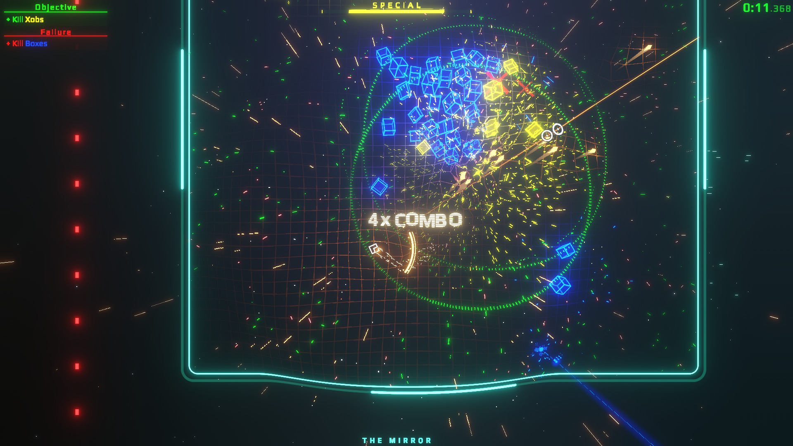

This is a test post that shows every Markdown element the blog supports. Body text is quiet on purpose, with **bold text** that lifts a little, *italics*, ~~strikethrough~~, `inline code`, and [a link to somewhere](https://example.com).

## A section heading

Paragraphs are separated by a blank line. Line breaks inside a paragraph are joined, so you can wrap text in your editor however you like.

### A smaller heading

- An unordered list
- With a few items
  - And a nested one
- Back to the top level

1. An ordered list
2. Counts for you
3. Like this

> A blockquote, for pulling something out of the text.

```ts
const greet = (name: string) => `Hello, ${name}`;
```

```csharp
// Spin an object at a steady rate
public class Spinner : MonoBehaviour
{
    [SerializeField] private float degreesPerSecond = 90f;

    void Update()
    {
        transform.Rotate(0f, degreesPerSecond * Time.deltaTime, 0f);
    }
}
```

```rust
/// Sum the even numbers in a slice
fn sum_even(values: &[i32]) -> i32 {
    values.iter().filter(|v| *v % 2 == 0).sum()
}

fn main() {
    let total = sum_even(&[1, 2, 3, 4]);
    println!("total: {}", total);
}
```

1. A longer ordered list
2. To check the numbers
3. Line up
4. Past nine
5. Five
6. Six
7. Seven
8. Eight
9. Nine
10. Ten



| Column | Another | Third |
| ------ | ------- | ----- |
| One    | Two     | Three |
| Four   | Five    | Six   |

---

Images and videos go in `public/images/blog/` and are written as ``. An `.mp4` or `.webm` plays like the project videos.
